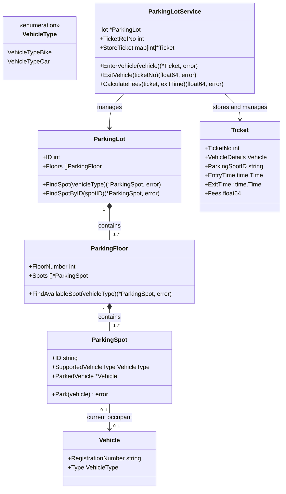
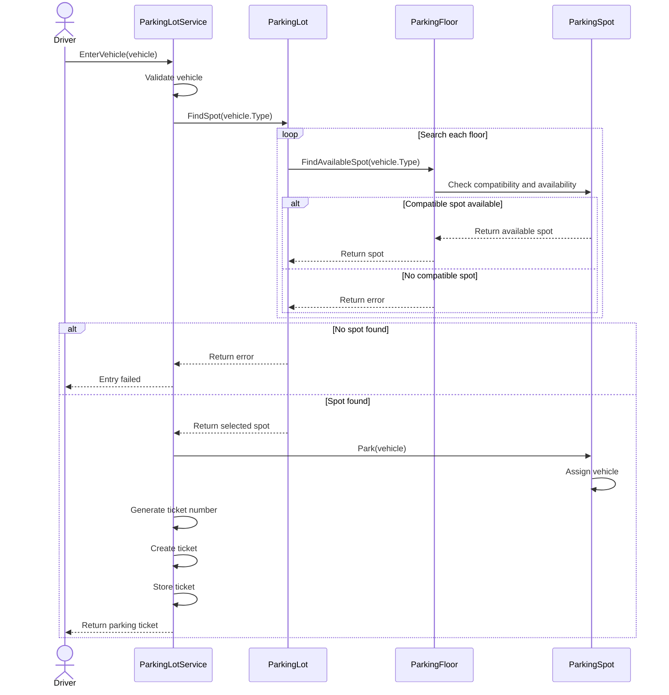
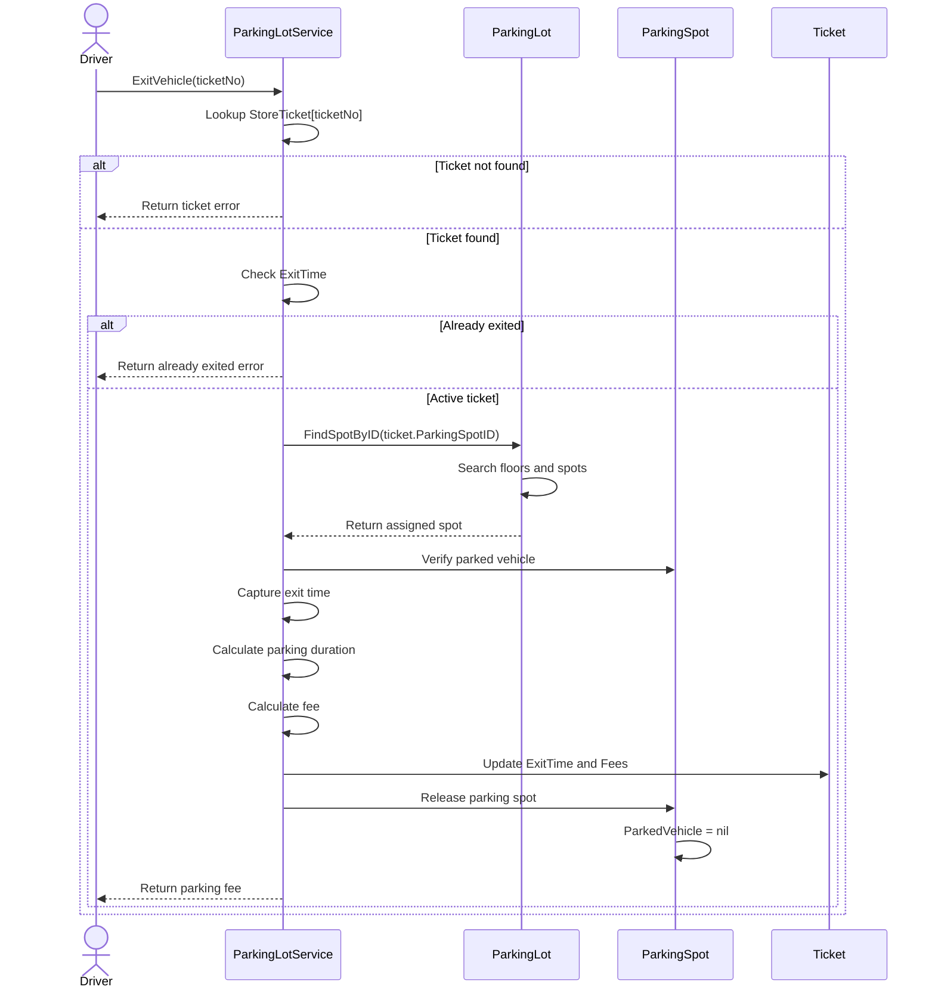

# Parking Lot System

A Low-Level Design (LLD) implementation of a multi-floor parking lot system using Go (Golang).

The goal is to design a parking lot that supports multiple vehicle types, automatically assigns available parking spots, generates parking tickets, and calculates parking fees when vehicles exit.

## 1. Problem Statement

Design a parking lot management system with the following capabilities:

- The parking lot contains multiple floors.
- The system supports cars and bikes.
- Each parking spot accommodates only one compatible vehicle at a time.
- The system automatically assigns an available parking spot when a vehicle enters.
- A parking ticket is generated for every vehicle entry.
- Entry and exit timestamps are recorded.
- Parking fees are calculated when a vehicle exits.
- The parking spot is released after a successful exit.

## 2. Functional Requirements

### Vehicle Entry

- Accept vehicle details, including registration number and vehicle type.
- Find an available parking spot compatible with the vehicle type.
- Search across multiple floors if a suitable spot is unavailable on the current floor.
- Assign the vehicle to the selected parking spot.
- Generate a unique ticket number.
- Record the entry timestamp.
- Store the generated ticket for future reference.

### Vehicle Exit

- Accept the ticket number.
- Retrieve the corresponding parking ticket.
- Validate that the ticket exists and is still active.
- Find the assigned parking spot using the spot ID stored in the ticket.
- Record the exit timestamp.
- Calculate the parking fee based on parking duration and vehicle type.
- Release the parking spot.
- Retain the completed ticket for historical reference.

## 3. Business Rules

### Supported Vehicle Types

| Vehicle Type | Description  |
| ------------ | ------------ |
| Bike         | Two-wheeler  |
| Car          | Four-wheeler |

### Parking Charges

The system charges for every started hour. Partial hours are rounded up to the next whole hour.

| Vehicle Type | Rate per Started Hour |
| ------------ | --------------------- |
| Bike         | ₹20                   |
| Car          | ₹50                   |

**Examples:**

| Vehicle | Parking Duration | Billable Hours |  Fee |
| ------- | ---------------: | -------------: | ---: |
| Bike    |        1.5 hours |              2 |  ₹40 |
| Bike    |          3 hours |              3 |  ₹60 |
| Car     |        2.3 hours |              3 | ₹150 |
| Car     |        2.8 hours |              3 | ₹150 |

## 4. Entities and Responsibilities

| Entity            | Responsibility                                                                                   |
| ----------------- | ------------------------------------------------------------------------------------------------ |
| Vehicle           | Stores vehicle registration number and vehicle type.                                             |
| VehicleType       | Defines supported vehicle categories.                                                            |
| ParkingSpot       | Stores spot ID, supported vehicle type, and currently parked vehicle.                            |
| ParkingFloor      | Maintains parking spots and finds available compatible spots on that floor.                      |
| ParkingLot        | Maintains multiple floors and searches for available spots across the parking lot.               |
| Ticket            | Stores ticket number, vehicle details, assigned spot ID, entry time, exit time, and parking fee. |
| ParkingLotService | Coordinates vehicle entry, exit, ticket creation, and fee calculation.                           |

## 5. UML Diagrams

UML diagrams are used to visualize the system design before implementation.

### 5.1 Class Diagram

The class diagram represents the main classes, their attributes, methods, and relationships.



### Class Relationships

- **Composition:** A parking lot contains multiple floors, and each floor contains multiple parking spots.
- **Association:** A parking spot can have an optional parked vehicle.
- **Directed association:** The parking lot service accesses the parking lot and manages tickets.
- **VehicleType:** Defines the supported vehicle categories.

### 5.2 Vehicle Entry Sequence Diagram

This sequence diagram represents the interactions that take place when a vehicle enters the parking lot.



### Entry Workflow Explanation

1. Driver provides vehicle details.
2. ParkingLotService validates the vehicle.
3. ParkingLot searches its floors for a compatible spot.
4. ParkingFloor searches its parking spots.
5. ParkingLotService assigns the vehicle to the selected spot.
6. A new ticket is generated with vehicle details, spot ID, and entry time.
7. The ticket is stored in the service's ticket map.
8. The generated ticket is returned to the driver.

### 5.3 Vehicle Exit Sequence Diagram

This sequence diagram represents the interactions that take place when a vehicle exits the parking lot.



### Exit Workflow Explanation

1. Driver provides the ticket number.
2. ParkingLotService retrieves the ticket from StoreTicket.
3. The system checks whether the ticket exists and is still active.
4. The assigned parking spot is located using its stored spot ID.
5. The current vehicle is verified against the ticket.
6. The exit timestamp is recorded.
7. The parking duration and applicable fee are calculated.
8. The ticket is updated with exit time and fee.
9. The parking spot is released.
10. The calculated parking fee is returned.

## 6. Go Implementation

The implementation uses Go structs, methods, pointers, slices, and maps.

### Important Go Concepts Used

- Custom types and constants for vehicle categories.
- Structs to represent parking lot entities.
- Pointer fields to represent optional parked vehicles.
- Methods with pointer receivers to modify parking spot state.
- Slices to maintain floors and parking spots.
- Maps to store and retrieve tickets using ticket numbers.
- Error handling using the `errors` package.
- `time.Time` and `time.Duration` for timestamp and duration calculations.
- `math.Ceil()` to round up parking duration.

### Ticket Storage

Tickets are stored in an in-memory map:

```go
StoreTicket map[int]*Ticket
```

- Key: Ticket number.
- Value: Pointer to the corresponding ticket.

This allows tickets to be retrieved directly using their ticket numbers.

## 7. Project Structure

```text
parking-lot/
│
├── README.md
│
├── requirements.md
│
├── uml/
│   ├── class-diagram.md
│   ├── entry-sequence-diagram.md
│   └── exit-sequence-diagram.md
│
├── go/
│   └── main.go
│
└── tests/
    └── parking_lot_test.go
```

## 8. Future Improvements

The current implementation focuses on the core parking lot workflow. Potential improvements include:

- Support additional vehicle types.
- Introduce different parking allocation strategies.
- Add multiple parking rate configurations.
- Implement payment processing.
- Add support for parking reservations.
- Persist tickets and parking information in a database.
- Handle concurrent vehicle entry and exit safely.
- Add unit tests for parking operations and edge cases.
- Introduce suitable design patterns as system requirements evolve.

## 9. Learning Outcomes

This problem provides practical experience in:

- Breaking down system requirements into entities and responsibilities.
- Designing UML class and sequence diagrams.
- Implementing object relationships in Go.
- Using pointers and value semantics.
- Separating responsibilities across structs and services.
- Implementing error handling and validation.
- Designing entry and exit workflows.
- Applying object-oriented design principles in Go.

---

**Language:** Go (Golang)
**Problem Type:** Low-Level Design (LLD)
**Status:** In Progress
